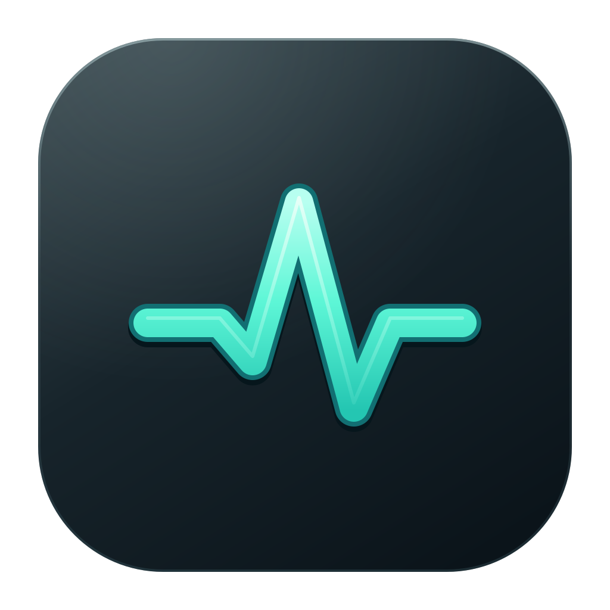
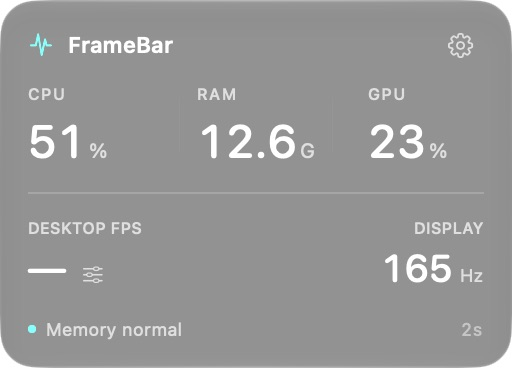
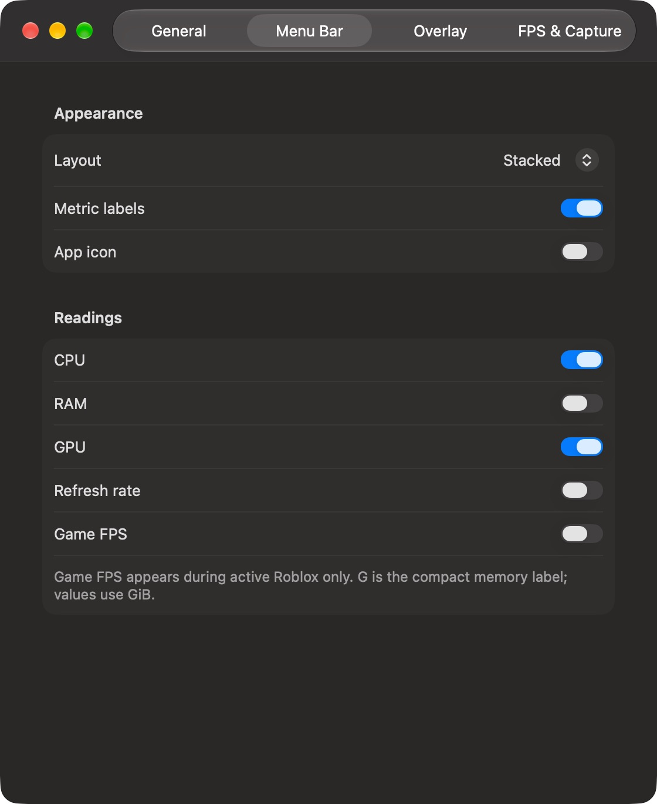
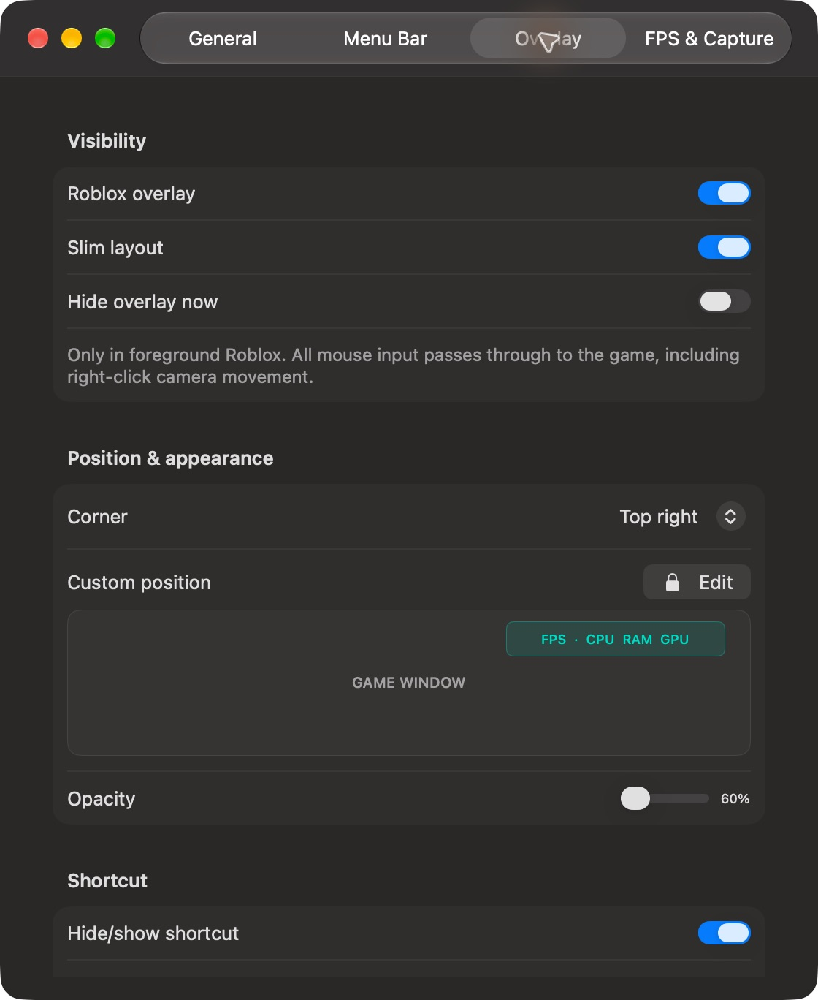

# FrameBar



A small native macOS 14+ menu bar CPU, RAM, GPU and display monitor. The click-through Apple-style game overlay appears only when Roblox has a visible window and is the frontmost app. It hides on the desktop, when you switch apps, or when you turn the overlay off. No Quartz or desktop FPS appears in the game overlay.

The floating menu panel is 256 × 184 points, with three hardware readouts, one FPS/display row, and a gear button for settings. It uses one native Liquid Glass surface on macOS 26+ and ultra-thin material on older systems, without a second window shadow. The game overlay defaults to one slim row. Click outside the menu panel or press Escape to dismiss it.

Gear → **Menu Bar** lets you choose single-row or two-line stacked readings, select CPU/RAM/Swap/GPU/refresh rate/game FPS independently, and toggle metric labels and the icon. Empty selections show an icon so the monitor stays accessible. These choices persist across launches. RAM and Swap are shown in GiB with compact **G** labels. Game FPS is blank outside active Roblox. Selecting game FPS can keep the two-second stats reader active during Roblox even if its overlay is disabled; desktop capture still runs only with the menu panel open.

Build, install into `~/Applications`, and launch:

```sh
./script/build_and_run.sh --verify
```

The project uses Xcode 26 or newer and XcodeGen. Open `FrameBar.xcodeproj` to edit it. The Codex Run action uses the same script. Local builds use an available Apple Development identity for stable macOS permission matching, falling back to ad-hoc signing if none exists. `FRAMEBAR_SIGN_IDENTITY` can pin a certificate explicitly. Switching from the old ad-hoc build may require approving screen access once for the new signature, then relaunching. The app is not notarized for distribution.

The app icon's editable vector source is [Assets/FrameBar.svg](Assets/FrameBar.svg). Its checked-in PNG exports are required by the macOS asset catalog. To regenerate them after editing the SVG, install `librsvg` and run `bash script/export_app_icon.sh`. RTK is optional for building the public project.

## Quick install

```sh
brew install --cask italian-seasoning/tap/framebar
```

Current preview: **1.0.2**. [Download the ZIP](https://github.com/Italian-seasoning/FrameBar/releases/download/v1.0.2/FrameBar-1.0.2-macOS.zip).

Requires macOS 14 or newer on Apple silicon or Intel.

These previews are not Apple-notarized. Homebrew verifies the archive checksum and leaves Gatekeeper enabled. If macOS blocks the first launch, review the app in **System Settings → Privacy & Security**. Sparkle verifies subsequent in-app updates with its signed feed.

## See the app







[Watch the interface walkthrough](docs/screenshots/framebar-walkthrough.mp4). This short sequence shows the captured interface views; it is not a gameplay or download benchmark.

Screenshots show local preview builds. Empty queues and standby states are shown where applicable.


## Readings

- CPU: system utilization, sampled from Mach CPU tick deltas. All cores together range from 0–100%.
- RAM: an estimate in GiB of app, wired and compressed physical memory, excluding file-backed and purgeable pages. It can differ slightly from Activity Monitor. Memory pressure comes from the system kernel pressure level.
- Swap: system swap space in use, reported in GiB.
- GPU: global device utilization from the GPU driver's I/O Registry performance statistics. A dash means the driver does not expose it. This is not per-game GPU usage or VRAM.
- Display refresh: Core Animation display-link timing, reprobed when Low Power Mode or the display changes. Shows unavailable while gathering fresh timing, rather than falling back to the configured 120 Hz mode. Low Power Mode on a variable-refresh panel shows **Adaptive** (**—Hz** in the menu bar): macOS can continue reporting 120 callbacks/s without establishing the panel's actual rate. The dash explicitly means that the current panel rate is unavailable; this remains an unresolved measurement limitation. Fixed-rate displays keep numeric timing. This is a scheduling estimate, not an independent panel measurement.
- Display cadence: Core Animation callbacks per second while the panel is open. It does not count WindowServer renders or Roblox frames.
- Desktop FPS: a capture-based estimate of changed frames on the selected display, counting ScreenCaptureKit `.complete` samples and excluding idle samples. It is capped at 240 captures/s. The monitor's own app is excluded from the captured content. This is not Apple's private Quartz Debug counter; capture throttling and load may produce different numbers. No images are retained. Desktop capture runs only while the menu panel is open and Roblox is inactive.
- Roblox FPS: reads an explicit FPS value from Roblox's visible debug stats using local Vision OCR at most once every two seconds, only while Roblox is active and an enabled overlay or open panel needs the reading. Show stats using Shift–F5 (Fn may be needed). Missing, unreadable or ambiguous stats show a dash. The top-left region is cropped before recognition. The reader does not inject into Roblox, unlock FPS, or change game files. Derived milliseconds are `1000 / FPS`, not measured CPU/GPU render time. OCR is sampled, so it does not support precise frame-time spikes or 1% lows.
- Roblox CPU: process CPU usage; 100% is one occupied core and may exceed 100%. Roblox memory is process resident memory in GiB.

## Screen access

For everyday FPS without OCR, **FPS & Capture → Native Metal FPS HUD** enables Apple's app-scoped live rendering HUD for Roblox, including Froststrap's Roblox client. Restart Roblox through Froststrap after changing it. Enabling it turns FrameBar's OCR reader off. FPS appears in Apple's HUD; it is not fed into FrameBar's game FPS field. FrameBar's hardware readings remain available. MicroProfiler dumps remain optional debugging captures.

The game overlay ignores mouse events and its hosting view never accepts hit tests. It cannot become a key or main window. The menu panel's outside-click observer exists only while that panel is open, so gameplay right-clicks do not trigger FrameBar window-ordering calls.

CPU/RAM/GPU/display timing need no permission. Both FPS readers need macOS screen-recording permission. Click **Allow screen access for FPS** in FrameBar and enable it in System Settings → Privacy & Security → Screen & System Audio Recording. Relaunch FrameBar if macOS asks. Pixels are processed in memory and discarded, with no audio recording, screenshots saved, network traffic, or administrator helper.

Overlay settings include four corners, two layouts, opacity, and 0.5/1/2-second metric updates. Under **Game Overlay → Position → Edit**, drag the mint preview or adjust the horizontal/vertical sliders, then choose **Lock**. Custom positions persist relative to the game window and stay within its edges as it resizes. Choosing a corner resets the custom position. The editor locks again when the panel is reopened; the actual game overlay always passes mouse clicks through, even while editing the preview. Top presets leave 64 points for game controls. **Overlay readings** selects FPS, CPU, RAM, GPU, derived frame period and visible ping; at least one remains selected. FPS-only has a smaller window. **⌃⌥⌘O** hides/shows the overlay using an OS hotkey, with no accessibility permission. The shortcut can be disabled; a conflict is reported in settings. Export CSV saves the latest five minutes only when you choose a location; unavailable readings are blank. Launch at login is optional and uses Apple's Service Management API.

## Diagnostics and frame captures

The settings panel shows the last FPS-reader result, actual screen-access preflight state, capture error domain/code, and a manual retry while Roblox is active. Screen permission enables capture; it does not create a game frame counter. Show visible debug stats with Shift–F5 or the performance summary with ⌘⇧F5 (Fn may be needed). OCR tries fast recognition first and uses accurate recognition for retries. Mixed render/physics rows and explicit render rates such as `Render: 144/s` are supported; physics and network rates are not treated as FPS. CPU/GPU milliseconds and ping are read only when explicitly labelled in the visible stats. No game logs, image files, network calls, injection, or private APIs are used by the reader.

Low overhead mode defaults on: OCR starts at 4-second intervals, adapts up to 30 seconds if FrameBar exceeds its CPU budget, and backs off when stats are missing. Serious thermal pressure or macOS Low Power Mode enforces at least 10 seconds. Standard mode uses 2 seconds while readings succeed. Desktop capture pauses in settings. CPU-only overlays do not trigger OCR. Diagnostics show FrameBar's own process CPU (100% = one core), resident MB, and the thermal state. Under 1% is a target to measure, not a guaranteed ceiling: captures, recognition and glass rendering can create temporary spikes.

Session summaries count independent successful OCR reads, not repeated cached readings, and show sampled average/min/max FPS plus peak Roblox CPU/RAM and system GPU. The five latest completed summaries persist locally; reset starts a fresh current summary. These sampled values cannot measure stutters or 1% lows.

**Diagnostics → Debug capture · frame timings & lows → Import frame capture** accepts a client MicroProfiler HTML dump with literal contiguous `Frames[i] = MakeFrame(...)` records, or per-frame CSV with a `frame_ms` column. HTML is parsed as text and never executed. Files are capped at 32 MB; malformed, discontinuous or unsupported formats are rejected. Capture results show average FPS, 1% and 0.1% lows, median/P95/P99 frame duration, worst duration and frames over 33.3ms. Lows are `1000 / mean duration of the slowest fraction of frames`, requiring at least 100 or 1000 frames respectively. They are historical capture results, not live readings. Short profiler dumps may be insufficient for lows, and GPU/CPU work duration is not automatically display presentation time. A real Roblox dump still needs user verification against the supported format.

Roblox saves client MicroProfiler dumps in `~/Library/Logs/Roblox`; see [MicroProfiler capture instructions](https://create.roblox.com/docs/performance-optimization/microprofiler). The current Roblox client does not provide FrameBar a documented live per-frame API. FrameBar does not substitute screen updates or sparse OCR samples for true game frame times.

## Resource use

The installed build uses Release optimization. Closed menu/overlay views are detached so they do not render; continuous display callbacks and desktop capture stop when the panel closes. A brief display-timing probe runs at most every 30 seconds. App detection uses workspace events, while window geometry is polled only for active Roblox. Sampling timers allow coalescing. Histories are bounded to five minutes. Menu readings use reserved slots so digit changes cannot resize the status item.

Capturely integration uses a small local snapshot under Application Support/FrameBar, without a network service or another screen capture. Capturely requests stats only while its process logging is enabled and a matching game is recording. Overlay options also include game process CPU/RAM, visible CPU/GPU timings and thermal state. These are sampled readings; live per-frame lows remain unavailable.

A 12-second local measurement after dismissing the panel, with no Roblox and no screen-access permission, measured 0.89% of one CPU core and 28–36 MiB resident memory. A stack sample showed no running display-link callback thread or SwiftUI drawing. These are short observations on this Mac, not guarantees. Screen capture and game OCR still require a separate benchmark after permission is granted.

The feature-update Release build averaged 0.011% of one core over a 20-second closed-panel measurement, with 63 MB resident memory. This idle result does not establish the CPU cost of live Roblox capture/OCR or an open glass panel.

```sh
rtk proxy xcodebuild -project FrameBar.xcodeproj -scheme FrameBar -derivedDataPath build test CODE_SIGNING_ALLOWED=NO
```

References: [Apple frame statuses](https://developer.apple.com/documentation/screencapturekit/scframestatus/idle), [Core Animation display link](https://developer.apple.com/documentation/quartzcore/cadisplaylink), [Roblox performance stats](https://create.roblox.com/docs/performance-optimization/identify).

## License and attribution

[MIT](LICENSE) — Copyright © 2026 [Italian-seasoning](https://github.com/Italian-seasoning). Forks and redistribution are allowed; retain the copyright and license notice. Please identify independently maintained forks and link back to this project. Third-party components retain their own licenses.
